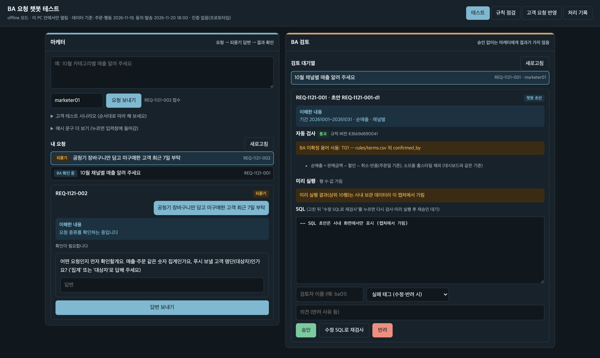
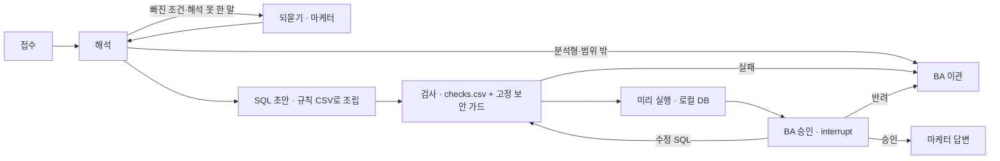

# BA 요청 처리 자동화 — FDE Academy 7주차 A트랙

가전 마케팅팀의 데이터 요청을 받아 **되묻기 → SQL 초안 → 자동 검사 → BA 승인**까지 이어 주는 LangGraph 챗봇 프로토타입입니다.
목표는 "일이 밀리지 않는다", 즉 요청 접수부터 BA 승인까지 걸리는 시간(리드타임)을 줄이는 것입니다.

## 들어 있는 것

| 결과물 | 내용 | 바로 가기 |
|---|---|---|
| **최종 보고서** | 고객 요구사항 · 동작 시스템 · KPI와 설득 방안 · 로드맵 · 고객 자체 유지보수 · 테스트 페이지 안내 | [웹에서 보기](https://yhkim-fde.github.io/fde-w7-ba-request-bot/) · 원본 `docs/index.html` |
| **챗봇 1 · offline 버전** | 규칙만으로 동작, 외부 호출 없음 (고객 제약 "LLM API 계약 없음") | [실행하기](#실행하기) |
| **챗봇 2 · Jev 버전** | 판단 모델 Jev(TypeSafe)가 요청 의도를 함께 판단 | [두 가지 버전](#두-가지-버전) · [키 넣는 곳](#실행하기) 5번 |


<sub>테스트 화면. 왼쪽은 마케터, 오른쪽은 BA 검토. 미리 실행 결과와 SQL은 캡처에서 가렸습니다.</sub>

## 무엇을 풀었나

| 항목 | 내용 |
|---|---|
| 고객 요청 | "우리 주문 데이터가 있고 데이터 애널리스트들이 있어. 업무를 자동화해 줘." |
| 현재 흐름 | 마케터 요청 → Jira 티켓 → BA가 댓글로 되묻기 반복 → Redshift SQL → 동료 검토 → 엑셀 → 발송 |
| 규모 | BA 3명 : 마케터 약 20명. 연말 성수기에 약 2주 지연 |
| 제약 | LLM API 계약 없음(실데이터를 모델에 넣지 않음) · SELECT 전용 · 허용 테이블만 · **BA 검토 없이 결과가 마케터에게 가지 않음** |

## 어떻게 동작하나



- **순서는 코드(워크플로우), 단계 안의 판단만 모델에.** 해석은 규칙 사전, SQL은 BA가 엑셀로 고치는 규칙 CSV 5종(`draft_chatbot/rules/`)으로 조립합니다.
- **BA 승인은 LangGraph interrupt(HITL).** 승인 전에는 마케터가 결과·SQL·건수를 받지 못합니다. 대상자 명단은 개인정보 확인이 있어야 승인됩니다.
- **보안 가드는 코드에 고정:** 단일 SELECT, 허용 테이블만 읽기, 실행 10초·20만 행 상한.
- **추측하지 않음:** 애매하면 되묻고, 분석형 질문·데이터 범위 밖은 BA에게 넘깁니다.

## 두 가지 버전

같은 코드에서 환경 변수 `BOT_JEV_MODE` 하나로 바꿉니다.

| 버전 | 설정 | 하는 일 | 키·네트워크 |
|---|---|---|---|
| **offline** (기본) | `BOT_JEV_MODE=off` | 규칙만으로 해석. 외부 호출 없음 | 필요 없음 |
| **Jev 사용** | `BOT_JEV_MODE=live` | 판단 모델 Jev(TypeSafe)가 "집계인지, 대상자 명단인지" 의도를 함께 판단. 규칙이 BA에게 넘기려던 요청 등에서 Jev가 확신하면 **이관·초안 대신 의도를 되묻는 쪽으로만** 바꿈 | Jev API 키 필요 |
| Jev 녹화 재생 | `BOT_JEV_MODE=replay` | 저장된 Jev 답(`tests/jev_cassettes/`)으로 재생. 키 없이 Jev 버전 동작 확인용 | 필요 없음 |

Jev에는 요청 문장과 고정 질문만 보냅니다(가명처리 후, 허용 호스트만, 감사 기록에는 원문 대신 지문만). 데이터 행이나 테이블 구조는 보내지 않습니다.

## 실행하기

Python 3.11 이상, [uv](https://docs.astral.sh/uv/) 기준입니다.

**1. 받기**

```bash
git clone https://github.com/yhkim-fde/fde-w7-ba-request-bot.git
```

```bash
cd fde-w7-ba-request-bot/draft_chatbot
```

**2. 설치** (Jev 버전도 쓸 거면 두 번째 줄까지)

```bash
uv venv --python 3.12 .venv && uv pip install --python .venv langgraph langgraph-checkpoint-sqlite langchain-core pydantic
```

```bash
uv pip install --python .venv "langchain-typesafe==0.1.0"
```

**3. 강의 실습 데이터** — 강의에서 배포한 DDL·마스킹 데이터·대시보드 쿼리가 `kit_download/`에 들어 있어 따로 받을 필요가 없습니다. 내용과 출처는 [kit_download/README.md](kit_download/README.md).

**4. 테스트 화면 열기** — 실행 후 브라우저에서 http://127.0.0.1:8765 (이 PC 안에서만 열림)

offline 버전:

```bash
.venv/bin/python -m bot.web
```

Jev 버전 (아래 5번에서 키를 넣은 뒤):

```bash
BOT_JEV_MODE=live .venv/bin/python -m bot.web
```

터미널로도 됩니다: `.venv/bin/python -m bot ask "10월 카테고리별 매출 알려 주세요"` (명령 전체는 [draft_chatbot/bot/README.md](draft_chatbot/bot/README.md))

**5. Jev API 키 넣는 곳** — 키는 저장소에 들어 있지 않습니다. 각자 발급받은 키를 넣습니다.

```bash
cp .env.jev.example .env.jev
```

그다음 `draft_chatbot/.env.jev`를 열어 `TYPESAFE_API_KEY=` 뒤에 키를 붙여 넣습니다(따옴표 없이). 이 파일은 `.gitignore`에 등록되어 커밋되지 않습니다. 파일 대신 환경 변수 `TYPESAFE_API_KEY`로 넘겨도 됩니다. 키가 없으면 `replay` 모드로 Jev 버전 동작을 볼 수 있습니다.

## 테스트

모두 `draft_chatbot` 폴더에서, 네트워크 없이 돕니다.

| 명령 | 확인하는 것 |
|---|---|
| `.venv/bin/python tests/run_scenarios.py` | 시나리오 22개 (BA 승인 우회 불가, 규칙 수정 반영, 범위 밖 이관 등) |
| `.venv/bin/python tests/evalset.py` | 평가셋 (결과 일치·해석·경고 없이 틀린 초안 0건) |
| `.venv/bin/python tests/run_jev_checks.py` | Jev 배선·가명처리·반영 규칙 R1·R2 |
| `.venv/bin/python tests/run_jev_flow.py` | Jev가 있어도 BA 승인 전 마케터 답변이 없는지 |
| `BOT_JEV_MODE=replay .venv/bin/python tests/run_casefile.py tests/marketer_cases.json` | 마케터 말투 문장 40개, Jev 녹화 재생 |

## 폴더

| 경로 | 내용 |
|---|---|
| `docs/index.html` | 최종 보고서 (GitHub Pages로 웹에 공개) |
| `draft_chatbot/bot/` | LangGraph 챗봇과 브라우저 테스트 화면(`web/`) |
| `draft_chatbot/rules/` | BA가 Claude 없이 직접 고치는 규칙 CSV 5종과 점검 도구 |
| `draft_chatbot/tests/` | 시나리오·평가셋·마케터 말투 시험 세트·Jev 녹화본 |
| `draft_chatbot/schema*.py` | 설계 스키마 (v1~v4) |
| `kit_download/` | 강의 실습 데이터 (DDL · 마스킹 CSV · 대시보드 쿼리) |

## 한계 (프로토타입)

- 해석은 사전·정규식 기반이라 정해진 표현만 이해하고, 나머지는 되묻거나 BA에게 넘깁니다.
- 지원 범위는 순매출·주문 수 집계와 구매·조회·장바구니·찜 기반 푸시 대상자입니다.
- 인증이 없습니다(누구나 BA로 승인 가능). 실제 도입 시 권한 분리가 필요합니다.
- SQLite는 Redshift 대역이라 SQL 방언 차이가 있습니다. 업무 용어는 FDE 초안이며 BA 확정 전입니다.
- 시험 세트는 고객 자료로 작성한 문장이며 실제 마케터 문장이 아닙니다.
