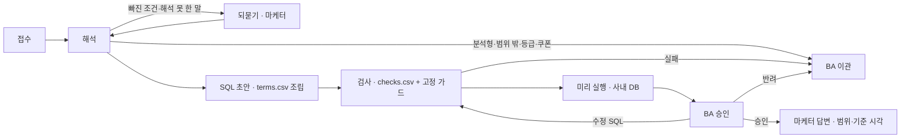

# BA 요청 챗봇 프로토타입 (offline)

스키마 v3(`../schema.py`)와 규칙 파일(`../rules/`)을 바탕으로 동작하는 LangGraph 챗봇입니다.
**외부 모델을 부르지 않습니다**(고객 제약: LLM API 계약 없음). 실행은 마스킹 추출본을 담은 로컬 SQLite(Redshift 대역)에서 합니다.



## 테스트 화면 (브라우저)

`draft_chatbot` 폴더에서 아래를 실행한 뒤 브라우저로 `http://127.0.0.1:8765` 를 엽니다. 이 PC 안에서만 열립니다(외부 반출 금지 데이터).

```bash
.venv/bin/python -m bot.web
```

- **테스트 탭:** 왼쪽 마케터(요청·되묻기 답변·결과), 오른쪽 BA(대기열·검사·미리 실행·승인/수정/반려). "고객 테스트 시나리오" 6개를 순서대로 따라 할 수 있음
- **규칙 점검 탭:** rules/*.csv 점검 결과, 업무 용어 확정 상태, 검사 규칙 목록
- **고객 요청 반영 탭:** C1~C13과 화면에서 확인하는 법
- **처리 기록 탭:** 요청별 결과·되묻기 수·리드타임 (프로토타입 기록)
- 승인 전에는 마케터가 결과·SQL·건수를 받지 못하고, 결과 파일도 승인 후에만 내려받을 수 있음

## 실행 (터미널)

`draft_chatbot` 폴더에서:

```bash
.venv/bin/python -m bot ask "10월 카테고리별 매출 알려 주세요"
```

| 누가 | 명령 |
|---|---|
| 마케터 | `ask "요청"` · `answer REQ-번호 필드=답` · `status REQ-번호` |
| BA | `queue` · `review REQ-번호` (보기) · `review REQ-번호 --draft 초안번호 --approve --reviewer 이름 [--pii-ack]` |
| BA | `review ... --revise --edit-sql 고친.sql --reviewer 이름 [--tag 실패태그]` · `review ... --reject "사유" --reviewer 이름` |
| 운영 | `rules` (규칙 점검) · `log` (요청 기록 요약) |

## 지키는 것

- **BA 승인 없이는 결과가 나가지 않음.** 승인 전 마케터에게는 "BA 확인 중"만 보임. 대상자 목록은 개인정보 확인(`--pii-ack`) 필수
- **BA가 고친 SQL도 다시 검사·미리 실행한 뒤 다시 승인**받아야 나감
- **규칙은 CSV가 원천.** BA가 `rules/*.csv`를 고치면 다음 단계부터 반영(버전 변경은 기록). 점검 실패·형식 오류면 처리 중단하고 BA에게 넘김
- **코드 고정 보안 가드:** 단일 SELECT, 허용 테이블만 읽기, 실행 10초·20만 행 상한 (CSV로 끌 수 없음)
- **추측하지 않음:** 부정 표현이 애매하거나 해석 못 한 말이 있으면 되묻기, 분석형 질문·등급 조건·데이터 범위 밖은 BA 이관
- **데이터는 사내에만:** 결과 행은 `var/results/`에만. 그래프 상태·기록에는 행 수·컬럼명만. LangSmith 추적 강제 OFF
- 챗봇의 "오늘"은 데이터 기준 시각(주문 11/19, 동의·발송 11/20 18:00)으로 고정

## 한계 (프로토타입)

- 해석은 사전·정규식 기반. 정해진 표현만 이해하고 나머지는 되묻거나 넘김
- 지원 범위: 순매출·주문 수 집계, 구매·조회·장바구니·찜 기반 푸시 대상자. 쿠폰 사용률은 기간 정의 확정 후
- 인증 없음(누구나 BA로 승인 가능) — 도입 시 권한 분리 필요
- SQLite는 Redshift 대역이라 방언 차이 있음
- 업무 용어는 FDE가 데이터로 확인한 초안. BA 확정(`confirmed_by`) 전

## 테스트

```bash
.venv/bin/python tests/run_scenarios.py
```

```bash
.venv/bin/python tests/evalset.py
```

둘 다 네트워크를 차단한 상태로 실행합니다.

## Jev 판단 모델 (S1·S2 그림자 운영 + S3 R1·R2)

Jev(TypeSafe)의 판단(J1 문장 필터 · J2 의도 · J3 부정 표현)을 기록하고, **의도 판단 중 두 경우만** 결정에 반영합니다. 근거와 측정 결과는 `Jev_baseagent_적용검토.md` 8·9장.

- **R1:** 규칙은 범위 밖으로 이관하려는데(분석어 없음) Jev가 집계·대상자로 p ≥ 0.95 → 이관 대신 "집계인가요, 대상자인가요?" 확인
- **R2:** 규칙과 Jev가 집계·대상자로 엇갈리고 Jev p ≥ 0.95 → 초안·다른 질문 대신 의도 확인 먼저
- 마케터가 의도를 답하면 그 답으로 다시 해석하고 R1·R2는 다시 작동하지 않습니다. 결과는 **이관 → 되묻기, 초안 → 되묻기** 쪽으로만 바뀌고, Jev 때문에 초안이 새로 생기지는 않습니다
- 반영은 실제 판단(live·record·replay)일 때만. stub·녹화 없음·호출 실패면 규칙 결과 그대로. `BOT_JEV_APPLY=0`이면 기록만 합니다
- J1 문장 필터와 J3 부정 표현은 기록만 합니다(J3는 '미구매'를 반대로 읽는 문제가 있어 보류)

- 기본값 `BOT_JEV_MODE=off`: Jev를 부르지 않습니다. 기존 동작과 같습니다.
- 키: `draft_chatbot/.env.jev`의 `TYPESAFE_API_KEY=` 뒤에 있습니다(이 저장소는 작성자 키 포함). Jev가 안 되면 이 값을 본인 키로 바꿉니다(확인 방법은 저장소 README 5번). 호출 경로·모델도 이 파일에서 바꿉니다.
- 보내는 것은 요청 문장(Jira면 '요청 사항' 칸)과 고정 질문뿐입니다. 보내기 전 가명처리, 남은 개인정보가 있으면 차단, 허용 호스트만. 감사 기록 `var/jev_audit.jsonl`에는 원문 대신 지문(sha)만 남습니다.

| 모드 | 동작 | 네트워크 |
|---|---|---|
| `off` | 부르지 않음 (기본) | 없음 |
| `stub` | 규칙을 흉내 낸 가짜 답. 배선 확인용, 성능 아님 | 없음 |
| `record` | 실제 호출 + 녹화(`tests/jev_cassettes/`, 답만 저장) | 필요 |
| `replay` | 녹화 재생. 없으면 stub 대체(`replay_miss_stub`로 표시) | 없음 |
| `live` | 실제 호출 | 필요 |

```bash
.venv/bin/python tests/run_jev_checks.py
```

```bash
.venv/bin/python tests/run_jev_flow.py
```

```bash
BOT_JEV_MODE=replay .venv/bin/python tests/run_casefile.py tests/marketer_cases.json
```

```bash
BOT_JEV_MODE=record .venv/bin/python tests/run_jev_shadow.py tests/marketer_cases.json --save tests/jev_shadow_marketer.txt
```

```bash
BOT_JEV_MODE=replay .venv/bin/python tests/run_jev_shadow.py tests/marketer_cases.json
```

웹 화면에서 켜려면 `BOT_JEV_MODE=live .venv/bin/python -m bot.web`처럼 실행합니다(요청마다 Jev 1회 호출). 요청이 끝나면 처리 기록에 Jev 판단 요약과 적용 규칙(R1·R2)이 붙습니다.
